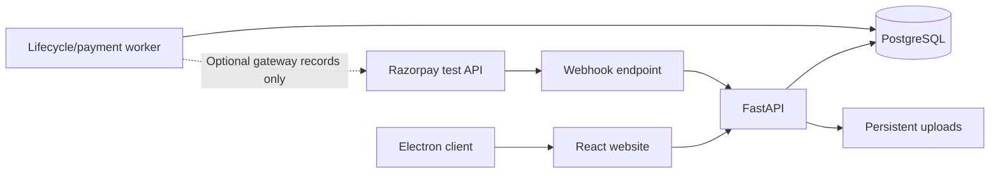

# Architecture and decisions

## Components

The current UI uses local demo checkout and the worker records demo refunds directly in PostgreSQL. The optional external path only processes gateway records.

| Module | Responsibility |
| --- | --- |
| core / credentials | Database, sessions, guards, hashing, rate limits |
| auth | Accounts, uploads, password change, development OTP |
| rentals | Listings, availability, requests, handover |
| services | Providers, tasks, quotes, schedule, delivery |
| bookings | Shared records, immutable agreements, PDFs |
| payments | Gateway and demo checkout, ledger, refunds, receipts |
| community | Messaging, notifications, reviews, reports, admin |
| community_worker | Periodic expiry/reminders and payment reconciliation |

## Persistence and concurrency

One modular backend owns business rules. PostgreSQL stores shared data; SQLite is for isolated tests. Row locks serialize availability and selection. Uniqueness constraints protect acceptances, reviews, payments, and notifications.

Dates use inclusive start/exclusive return. Booking terms are snapshots; agreement acceptance stores version/hash. Evidence does not rewrite terms. Confirmed changes require cancellation/rebooking unless amendments are explicitly implemented.

## Security

Salted scrypt protects passwords. HTTP-only SameSite=Lax cookies reference server-side hashed session tokens. Secure cookies depend on environment. Mutating requests with an Origin header are checked against allowed origins.

Rate limits and OTP challenges are process-local. Development OTP returns the code to the requester: it is not SMS delivery or proof of phone ownership. Password changes invalidate other sessions. Account, ownership, participant, and admin guards remain server-side.

Uploads accept up to 5 MiB, JPEG/PNG/WebP, and 12 megapixels, then normalize to generated JPEG filenames. PostgreSQL stores metadata; persistent disk stores files. Backup must preserve both.

## Financial boundary

Amounts use integer paise, commission basis points, and distinct capture/refund/earnings records. Provider earnings remain unsettled. No escrow or successful payout is claimed.

**Accepted user decision:** use demo payments. Development checkout and refunds use distinct demo identifiers; external gateway events cannot settle demo records. The worker processes demo refunds without credentials or network calls. Receipts state that no money moved.

## Desktop and deployment

Electron uses sandboxing/context isolation, no renderer Node integration/webviews, denied new windows, and same-origin top-level navigation. Backend secrets remain outside the renderer.

Local Windows scripts use Aiven. Docker uses its own database. Multi-device use requires a shared reachable server. Packaging does not verify installation, downloads, payment popups, or window behavior interactively.
